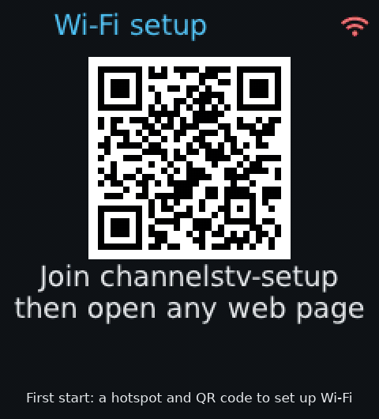

# channelstv

Live TV and recordings from a [Channels DVR](https://getchannels.com/dvr-server/) on a small
ESP32-S3 touchscreen, through the [DLNA bridge for Channels DVR](https://github.com/hdhrgit/dlna-bridge).

The bridge converts each stream into something the board can decode (H.264 Constrained
Baseline, one slice per frame, sized for the board's screen, with mono AAC-LC audio). The board finds the
bridge on the network by itself, lists what the bridge serves, and plays it with sound.



The pictures come from the board's own screen (`/api/screen`); recording titles are blurred, and the address shown is an example.

## Boards

One image runs on all of them: the board is told apart at start-up, and Settings → **Version &
board** says which one it found.

| | [ESP32-S3-Touch-LCD-1.54](https://docs.waveshare.com/ESP32-S3-Touch-LCD-1.54) | [ESP32-S3-Touch-AMOLED-1.8](https://www.waveshare.com/wiki/ESP32-S3-Touch-AMOLED-1.8) |
|---|---|---|
| Screen | 240x240 LCD (ST7789, SPI) | 368x448 AMOLED on QSPI: SH8601 (V1) or CO5300 (V2) |
| Touch | CST816 | FT3168 (V1) or CST816 (V2) |
| Picture asked of the bridge | the `esp32` profile's (240 wide) | 368x206 (4:3: 320x240) |
| Rows a page | 4 | 6, and a heading as tall as a row |
| Keys | PWR, VOL+, VOL- | PWR and BOOT (see [Using it](#using-it)) |
| Battery | through a latch and the ADC | the AXP2101 power chip |
| Turning the board | the whole screen turns | the menus stay upright; video turns, sideways across the whole width |

Both have an ESP32-S3 with 16 MB flash and 8 MB PSRAM, an ES8311 speaker codec, a QMI8658 motion
sensor and a Li-ion battery. On the AMOLED-1.8 each video frame is written just behind the panel's
refresh, timed by its tearing-effect line (GPIO13), so a frame never shows half old, half new
(`/api/settings?tesync=0` turns that off until the next start, to compare).

## Installing

Each [release](https://github.com/hdhrgit/channelstv/releases) has two images and their
checksums:

| File | What it is |
|------|------------|
| `channelstv-<version>-full.bin` | bootloader, partition table and app in one, to flash at `0x0` over USB |
| `channelstv-<version>-ota.bin` | the app alone, for updating a board that already runs channelstv |
| `SHA256SUMS` | `sha256sum -c SHA256SUMS` checks both |

**First install, over USB:** plug the board in (it shows up as `/dev/ttyACM0` on Linux,
`/dev/cu.usbmodem*` on macOS, a COM port on Windows) and flash the full image with
[esptool](https://docs.espressif.com/projects/esptool/) (`pip install esptool`):

```sh
esptool.py --chip esp32s3 -p /dev/ttyACM0 write_flash 0x0 channelstv-<version>-full.bin
```

If the port doesn't show up, hold BOOT while pressing RESET to put the board in download mode,
flash, then press RESET. The full image also covers the settings area, so the board starts
fresh: with no Wi-Fi network saved, it opens the setup hotspot (below). To keep the settings,
update over Wi-Fi instead.

**Or from the browser:** in Chrome or Edge on a desktop computer, open Espressif's
[web flasher](https://espressif.github.io/esptool-js/), click **Connect** and pick the board's
port, enter `0x0` as the flash address, choose `channelstv-<version>-full.bin` and click
**Program**. Press RESET when it's done.

**Updating over Wi-Fi:** OTA updates are off on a fresh install. Turn them on with a finger on
the board, Settings → **OTA updates**; the web page and the API can't turn them on, only off
(`/api/status` says `ota_enabled`). Then send the OTA image:

```sh
curl --data-binary @channelstv-<version>-ota.bin -H 'Content-Type: application/octet-stream' http://<board-ip>/api/ota
```

The board writes it to its spare app slot and restarts. If the new image can't get onto Wi-Fi
within 90 seconds, the board goes back to the previous one.

## Wi-Fi setup

With no network saved, the board opens its own hotspot, **`channelstv-setup`** (no password),
and shows a QR code for it:

1. Scan the QR code with a phone camera, or join `channelstv-setup` in the phone's Wi-Fi
   settings.
2. The setup page opens by itself. If it doesn't, open any `http://` address in the browser.
3. Pick the network, enter its password and tap **Join**. The page and the screen say how it's
   going ("Wrong password for ...?", "... not found").
4. Once the board is on the network, the page shows its address and the hotspot closes after
   30 seconds. Join your network again and open that address.

The network is saved. If it can't be reached two minutes after a start (a new router, a new
password), the hotspot opens again next to it. Meanwhile the board keeps trying the saved
network every 30 seconds.

To move the board to another network later, open `http://<board-ip>/wifi` (needs Web control:
full). **Forget this network** there (or `POST /api/wifi/forget`) clears the network and
restarts into the hotspot.
The setup page then offers **Back to <network>** for the one just forgotten.

## Using it

- **Screen:** the bridge's folders (Live TV, Favorites, Recent recordings, TV Shows, Movies,
  Recording now, Channels by source) and Settings, four big rows a page (six on the AMOLED-1.8);
  the page number is at the top right. The last page of a folder shows its last full page of rows.
  - Swipe up for the next page, down for the previous one; swipe right (or tap the arrow at the
    top left) to go back. A quick flick slides through many pages, with the page number shown
    large, and stops on the page it lands on; the faster the flick, the further. A tap stops it.
  - Tap a folder to open it, a channel or a recording to play it. "Tuning... N s" covers the
    screen until the first picture (the DVR can take 15-30 s to start a channel; a tap there
    cancels).
  - In Live TV, a long press opens a number pad: type a channel number (`.` for subchannels) and
    tap ▶. Swipe left (or tap the heading) to delete a digit.
- **While playing:** tap the picture for the controls, a 3x3 grid that hides after 4 s: channel
  down / Info / channel up, volume down / Stop / volume up, Back / the title / Hide. Swipe up or
  down for the next or previous channel (the next or previous item of the folder), swipe right
  to stop.
- **Recordings:** when the bridge offers a recording with DLNA time seek (its client is set to
  seek by time, see [Bridge setup](#bridge-setup)), the controls' volume keys become ⏮ 30 s
  and ⏭ 30 s; the
  volume stays on the VOL keys. Taps add up (three taps: 1:30) and the seek happens 0.8 s after
  the last one, showing where it lands ("+1:30", "→ 12:40 / 44:00"). Info shows how far the
  recording has got. A recording left part-way resumes there the next time it's played (the
  place is kept in NVS; within its first 30 s or last minute it starts from the top). A
  stream that ends before the recording's last minute keeps the place too. Where
  the bridge says it was left (`upnp:lastPlaybackPosition`, shared with the DVR's other players)
  comes first. A dot marks recordings not watched yet (`upnp:playbackCount` 0). The board
  asks for the start with a `TimeSeekRange.dlna.org: npt=<seconds>-` request header. A
  recording offered without time seek plays from the start to the end.
- **Settings:** Touch test (tap five dots; the board works out how the touch panel lines up with
  the screen and keeps it), the picture shape (16:9 or the centre 4:3), Frame rate (24, 20 or
  15 fps: what the board asks the bridge for; 24 by default on the 1.54, 15 on larger panels), Rotation, Backlight
  (20 to 100 %), Dim and Off (on battery, after 30 s or 1, 5 or 10 minutes untouched, and after
  1, 5, 10 or 30 minutes, or never; a touch or key brings it back), Find the bridge again, and
  Version & board (the firmware version; tap it for the board's address, the bridge's address,
  version, how it was found and its whole name, then the board, its display, each chip with its
  ID and whether it answered, the firmware build, the Wi-Fi signal and channel, the battery,
  free memory, uptime and why it last started).
- **Rotation:** by default the screen turns with the board. The motion sensor (QMI8658) says
  which edge is down; the picture turns once the board has stayed that way for a second, and
  not while it lies flat. Settings, the web page and `/api/rotation` set it to auto or a fixed
  0°, 90°, 180° or 270° (the board turned clockwise that far) instead. The touch test always
  runs the panel's own way up. On the AMOLED-1.8 only the video turns; the menus stay upright.
- **Keys:** PWR stops playback, or goes back a folder. Hold PWR for 3 s to power off on battery.
  VOL+ and VOL- change the volume. On the AMOLED-1.8: PWR (the lower key) does the same and
  switches the board on; BOOT (the upper key) also stops playback or goes back, and held it turns
  the volume down 5 % at a time, back up from 0 to 100 and down again, stopping at 50 % the
  second time round.
- **Web page and API:** see [below](#web-page-and-api); read-only until Settings → Web control
  says otherwise.

Live channels keep about 8 seconds in hand, so the gaps in the bridge's delivery don't stall the
picture. Anything beyond that is trimmed by playing 4 % faster (one audio frame in 25 left
out); if the board falls minutes behind, it skips ahead to what the bridge has just received.

## Web page and API

The board serves a web page and an HTTP API on port 80, at `http://<board-ip>/` (for example
`http://192.0.2.10/`). Settings → **Version** shows the board's address on its screen; the
router's list of devices has it too.

**Web control** (Settings) says how much of it answers:

| Web control | What answers |
|---|---|
| **read-only** (the default, also after updating) | the status page and `GET /api/status`; everything else is `403` |
| **full** | all of the below |
| **off** | nothing: no web server runs |

Only a finger on the board loosens it; the web page, the API and `/api/touch` can't. OTA updates
(`POST /api/ota`) keep their own switch, Settings → **OTA updates** (off on a fresh install),
which works the same way. While the setup hotspot is open, its page and `/api/wifi*` answer
whatever Web control says.

With Web control **full**, the page shows the status, browses the bridge's folders, searches
titles and plays from them, sets the bridge address, the picture shape, the frame rate, the rotation, the
backlight, when the screen dims and goes off on battery, and the volume, and shows a picture of
the screen. The API (all `GET` unless shown):

| Address | What it does | Read-only |
|---|---|---|
| `/` | the page (only the status while read-only) | yes |
| `/api/status` | the board, Wi-Fi, battery, memory, the bridge, playback, Web control and OTA | yes |
| `/chips`, `/api/chips` | the board and its chips, their IDs, and what the motion sensor, battery and touch read now | yes |
| `POST /api/ota` | an app image (`channelstv-<version>-ota.bin`) to flash and restart into | its own switch |
| `/api/settings?bridge=host[:port]&picture=16x9\|4x3&fps=15\|20\|24&volume=0..100&brightness=20..100&dim=30s\|1\|5\|10\|never&off=1\|5\|10\|30\|never` | sets any of them; `bridge=` empty goes back to finding it | |
| `/api/settings?size=WxH&tesync=0\|1` | until the next start: another picture size to ask the bridge for (`0x0`: the board's own), and the AMOLED-1.8's frame timing | |
| `/api/rescan` | looks for the bridge again | |
| `/api/browse?id=ID&start=N` | a page of a folder (`0` is the top) | |
| `/api/search?q=WORDS&start=N` | recordings, movies and shows whose titles hold every word; `{"no_search":true}` if the bridge can't search (the page then looks through its folders) | |
| `/api/play?url=U&title=T&live=1&id=ID&duration=S&seek=1&at=S`, `/api/stop` | plays a stream, stops; `id`, `duration`, `seek` and `at` (from `/api/browse`) give a recording its seek keys, position and resume | |
| `/api/seek?by=±seconds` | where a recording is; `by=` seeks it | |
| `/api/tv` | playback progress and the stream's state | |
| `/api/touch?gesture=tap\|long\|up\|down\|left\|right&x=&y=` | acts as a finger would; the last touch points | |
| `/api/screen` | what the screen shows, as a BMP the screen's size | |
| `/api/rotation?set=auto\|0..3` | the screen's rotation | |
| `/wifi`, `/api/wifi`, `/api/wifi/scan`, `POST /api/wifi`, `POST /api/wifi/forget` | Wi-Fi setup | while the hotspot is open |

[`main/web.h`](main/web.h) has every parameter.

**Security:** it's plain HTTP with no login and no HTTPS, made for a home network you trust.
Anyone who can reach the board can use what Web control allows, so keep it read-only (or off)
unless you are using the page, and turn OTA updates on only to update; only a finger on the
board loosens either. The setup hotspot has no password while it runs.

## Finding the bridge

The board needs [dlna-bridge](https://github.com/hdhrgit/dlna-bridge) running on the same network.

By default the board finds the bridge itself:

1. It sends an SSDP `M-SEARCH` for `urn:schemas-upnp-org:device:MediaServer:1` and keeps the
   answers whose `SERVER` header carries the bridge's `dlna/<version>` token.
2. It fetches each one's device description and accepts the first whose `manufacturerURL` is
   `https://github.com/hdhrgit/dlna-bridge`. Its address is taken from the description's URL.
3. It checks that the bridge's `/api/state` answers.

The description URL and the bridge's UDN are saved, so the next start tries there first. If
browsing or playing later fails to connect, the board searches again. If nothing answers, the
screen says so and the board searches again every 30 seconds.

**Setting the address by hand:** enter the bridge's address on the web page (needs Web control:
full), for example `192.0.2.20` or `my-dvr:8200` (the port is 8200 if left out). With an
address set, the board uses only that address and doesn't search. If that address doesn't answer, the screen says so.
Clear the field to go back to finding the bridge automatically.

## Bridge setup

The board asks for the client profile `esp32` (16:9, 240x144). It adds `?profile=esp32` to its
requests and sends the User-Agent `channelstv/<version>`. Without this client the bridge sends
the DVR's original stream, which the board can't decode. For the centre 4:3 of the picture
(Picture in Settings or on the web page) it adds the bridge's overrides
`w=240&h=192&fit=crop43` to the stream URLs, which needs dlna-bridge v0.99.10 or later.

Newer bridges have the `esp32` profile built in, so there is nothing to add; a client named
`esp32` in the bridge's settings still takes its place, for tuning. On older ones, add it as
below.

The board checks the profile whenever it finds the bridge: it reads the bridge's `/api/state` (it
never writes to the bridge), takes the `esp32` client from its settings or else the built-in
one, and wants it to transcode to H.264 `baseline`, one slice a frame (`single_slice`), at most
240 pixels wide. If it is missing or different, the board doesn't play. The screen says "Bridge needs the esp32 profile, see README" with the
reason, and so do the web page and `/api/status` (`bridge.profile_problem`). A stream that still
won't decode ends with the same message.

The board also needs dlna-bridge 0.99.12 or later, which sizes the picture the way the board asks
(`fit=width`, `fit=height`). With an older bridge it doesn't play, and the screen and the web page
say "Update dlna-bridge to 0.99.12 or later" (`/api/status`: `bridge.update` is the version needed).

On a bridge without the built-in profile, add the client on its settings page, or with `curl` and
[`jq`](https://jqlang.org/). `PUT /api/config` takes the whole configuration, so this reads the
current one from `/api/state`, puts the client in (replacing any with the same name) and
sends it back:

```sh
BRIDGE=http://<bridge-host>:8200
curl -s $BRIDGE/api/state | jq --argjson new '[
  {"name": "esp32", "user_agents": ["channelstv"],
   "profile": {"mode": "transcode", "ads": "cut", "seek": "time",
     "transcode": {"max_width": 240, "max_height": 144, "fps": 24, "video_kbps": 250,
       "audio_kbps": 64, "audio_channels": 1, "h264_profile": "baseline",
       "pre_scale": true, "exact_size": true, "single_slice": true}}}
]' '.config | .clients = ([.clients[]? | select(.name != "esp32")] + $new)' |
curl -s -X PUT -H 'Content-Type: application/json' --data-binary @- $BRIDGE/api/config
```

Then tap **Find the bridge again** in Settings (or restart the board) so it checks again.
`"ads": "cut"` plays recordings without their ads; leave it out to keep them. `"seek": "time"`
offers recordings with DLNA time seek, for the board's 30 s keys and resume (on the settings
page: Seeking, by time); with `"bytes"` they play from the start to the end.

## Building

Releases are built by GitHub Actions ([`.github/workflows/build.yml`](.github/workflows/build.yml))
with ESP-IDF v5.4.2. Every push builds, and a `v*` tag publishes a release. The build is
reproducible (`CONFIG_APP_REPRODUCIBLE_BUILD`): the image carries no build paths or dates.

To build it yourself, you need [ESP-IDF](https://docs.espressif.com/projects/esp-idf/en/v5.4.2/esp32s3/get-started/)
5.4. The other components (LVGL, the display and touch drivers, `esp_h264` and the audio codecs)
come from the ESP Component Registry on the first build, and
[VideoJet](https://github.com/hdhrgit/VideoJet) (Apache-2.0) from git, pinned to a commit in
[`main/idf_component.yml`](main/idf_component.yml).

```sh
. $IDF_PATH/export.sh
idf.py set-target esp32s3
idf.py menuconfig   # optional: channelstv -> Wi-Fi network and password
idf.py build
idf.py -p /dev/ttyACM0 flash monitor
```

**Wi-Fi:** the board uses the network the Wi-Fi driver last saved. If none has been saved, it
uses the network set in menuconfig, and without one it opens the setup hotspot (see
[Wi-Fi setup](#wi-fi-setup)). You can also send `W<ssid>\t<password>\n` over the USB
console (for example `printf 'Wmy-network\tmy-password\n' > /dev/ttyACM0`). The board saves it
and connects.

**Updating over Wi-Fi:** `build/channelstv.bin` is the OTA image; send it as shown under
[Installing](#installing).

## Layout

| File | What it does |
|------|--------------|
| `main/main.c` | Start-up, Wi-Fi, keys, power management, rollback |
| `main/setup.c`, `main/setup.html` | The Wi-Fi setup hotspot, its DNS server and page |
| `main/board.c` | Board bring-up for each board: display, touch, speaker codec, keys, battery, the chip list |
| `main/bridge.c` | SSDP discovery, the bridge's description, ContentDirectory Browse (SOAP, DIDL-Lite) |
| `main/stream.c` | The HTTP stream: read-ahead ring, reconnects, catching up with the live edge |
| `main/ts.c` | MPEG-TS demuxer (PAT, PMT, PES) and the H.264 SPS size |
| `main/tv.c` | Playback: demuxer, decoder and draw tasks, A/V sync on the audio clock |
| `main/h264dec.c` | H.264 decoding (VideoJet, or Espressif's `esp_h264` in menuconfig) and YUV to RGB565 conversion, turned and stretched for a sideways picture |
| `main/player.c` | AAC decoding, mono mix, resampling, the speaker |
| `main/ui.c` | LVGL screens |
| `main/web.c`, `main/index.html`, `main/chips.html` | Web page, the board and chips page, and the API |

The text font is DejaVu Sans (`main/DejaVuSans.ttf`), under its own free license.
